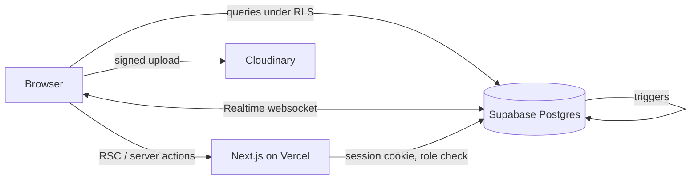

# Steady: project overview

A reference for writing about this project, for example as a portfolio case study.
Everything here reflects the code on `dev` as of September 2026. Figures come from the
repository, not estimates.

## In one paragraph

Steady is a web platform for a school's guidance and counseling office. Students book
counseling sessions online, track and cancel them, record how they are feeling, and
get articles, playlists and events picked for that mood. Counselors review and decide
on requests, manage their availability and keep session notes. Administrators manage
accounts, publish the content students see, and watch activity on a dashboard. It
started as a university school project and was later audited, rebuilt and rebranded as
Steady, an independent early-access product that isn't affiliated with any university.

## Naming and history

- **2025, school project.** Built as the "GCS System" (Guidance and Counseling
  Services) for a university guidance office by a team of five, with John Carl Ramirez
  as lead developer. It was pitched to the office and approved, but never deployed;
  development stopped after submission.
- **September 2026, audit and rebuild.** A full review found about 120 defects across
  authentication, the database, missing configuration, notifications, UI and
  performance.
  - The data layer, authentication and notifications were rebuilt.
  - The UI moved to a documented design system.
  - The product was renamed Steady with its own logo and legal pages, removing the
    original office's branding.
- **Public copy.** Use "Steady". Describe the origin as a university guidance office
  project, and say plainly that Steady is not affiliated with any university.

## The problem

Guidance offices often run on paper and walk-in visits. Booking a session means going
to the office in person, which some students find uncomfortable enough to skip. Records
are kept by hand, and there is no central place for announcements or wellness
resources. Counseling data is also confidential, so any digital replacement has to keep
students' information private from each other, and from staff who aren't involved.

## Who uses it

| Role      | What they do                                                                                                                                                         |
| --------- | -------------------------------------------------------------------------------------------------------------------------------------------------------------------- |
| Student   | Sign up with an informed-consent step, book a free slot with their department's counselor, reschedule or cancel, check in on their mood, read curated content        |
| Counselor | Accept, decline, reschedule and complete requests; set working days and hours; add session notes; see live counts                                                    |
| Admin     | Manage student and counselor accounts and departments, publish announcements, articles and playlists, export data, view the analytics dashboard, edit office details |
| Visitor   | Browse the public home page and the resource portal without an account                                                                                               |

Each role gets its own area and navigation, not the same screens with buttons hidden.

## Architecture

### Stack

- **App:** Next.js 16 (App Router, Server Components, server actions, route handlers),
  React 19, TypeScript
- **Data and auth:** Supabase (PostgreSQL, Auth, Row-Level Security, Realtime)
- **Client data:** TanStack Query (caching, optimistic updates), TanStack Form, TanStack
  Table; zod 4 for validation shared by client and server
- **UI:** Tailwind CSS 4, shadcn/ui on Radix primitives, lucide icons, Recharts,
  next-themes (light/dark), sonner (toasts)
- **Media:** Cloudinary, with signed direct uploads from the browser
- **Quality and delivery:** Vitest (73 unit tests), a 29-check SQL security suite,
  GitHub Actions (lint, types, tests, migrations applied to a fresh database), Vercel

### How it is put together

- **Server-first pages.** Public pages (home, portal, legal) render on the server.
  Signed-in areas load the viewer on the server in the layout and pass it down through a
  context provider, so identity always matches the session cookie. The rebuild removed
  the original's localStorage identity, which caused sign-in dead-ends.
- **Reads and writes are split.** Reads are plain functions taking a Supabase client
  (`src/lib/<domain>/queries.ts`), so the same query works in a Server Component or in
  `useQuery`. Writes are server actions (`actions.ts`): each checks the role, validates
  with the same zod schema as the form, and returns a typed `Result`
  (`{ ok, data } | { ok: false, error }`) instead of throwing. Production builds hide
  thrown messages.
- **Hierarchical query keys** carry the user's id where data is per-user, so one
  person's cache can't answer for another's, and invalidating a domain root refreshes
  every filtered and paged view of it.
- **A proxy** (Next.js 16 middleware) refreshes the session on every request and routes
  each role to its own area, with segment-exact path matching and no redirect loops.
- **Environment variables** are validated at startup with zod. A missing key fails
  with a message naming the variable, not a cryptic error on every route.

### Database and security

- **16 SQL migrations** kept in the repository. CI applies them to an empty database on
  every change to prove they still build from scratch.
- **Row-Level Security** on every table is the real access boundary. A counselor sees
  only students and appointments in their departments. Students see only their own
  records. Notifications are readable only by their owner.
- **Guard triggers** enforce rules the UI can't be trusted with:
  - Students can only cancel their own pending or approved appointments.
  - Counselors can't reassign an appointment to another student.
  - Nobody but an admin can flip a disabled flag or move a student between
    departments.
  - A time slot already held can't be double-booked.
- **Sign-up is atomic.** A trigger on the auth user creates the profile, role and
  emergency contacts in the same transaction, so a failure leaves no orphan account.
  Sign-up metadata can never grant a role.
- **Function grants** are revoked by default and granted back only where needed.
- **A verification script** (`scripts/db/verify.sql`) runs 29 checks against the live
  database as each seeded role, always rolled back. For example: a student can't
  approve their own booking, anonymous visitors can't read schedules, an admin
  cancelling notifies both parties.

### Real-time notifications

- **Created only by the database.** Triggers on appointment changes insert them, so no
  client can send one. Everyone involved is notified except the person who acted: a
  booking reaches the counselor, an approval the student, an admin's change both.
- **Delivered live over Supabase Realtime** to a notification bell.
  - Each mount opens its own channel. This fixed a bug where a reused channel went
    deaf after navigation and counselors needed a full reload to see new bookings.
  - It refetches after reconnecting and when a tab becomes visible, and dedupes
    events.
  - Reads and deletes sync across tabs.
- **A second listener** refreshes appointment lists, available slots and the admin
  dashboard for every role as appointments change.
- **Device notifications** while the site is open. The user opts in from the bell, and
  notifications go through a small service worker, which works on Android. An app
  manifest lets iPhone users add Steady to their home screen, the only way iOS allows
  web notifications.
- **Pure, tested feed logic.** Add, update and remove are pure functions with unit
  tests.

### Uploads and content

- **Signed direct uploads.** Images go straight from the browser to Cloudinary with a
  server-signed request. That lifted the original 1 MB server-action limit and stopped
  arbitrary uploads. Only admins can sign content uploads, and folders are fixed on the
  server.
- **Admin-only deletes.** Only admins can delete, and only inside the app's own folders.
- **Mood-based curation.** Content is tagged by mood, and the portal curates articles
  and playlists to the student's last check-in.

## User interface and experience

### Design language

- **Calm and flat.** White cards on an off-white page, separated by 1px borders rather
  than shadows. Generous spacing, large radii, a light display weight for big headings.
- **Amber means action.** A darker amber brand colour (4.84:1 contrast with white text,
  up from about 2:1 originally) is kept for primary buttons, selected states, unread
  dots and focus rings.
- **Tokens only.** Every colour is a semantic token (`bg-card`, `text-muted-foreground`,
  status tokens for appointment states). That made a full dark theme a token swap
  rather than a rewrite.
- **Written down.** Rules live in `docs/ui-guidelines.md`: tokens, type scale, radius,
  a component map, forms and dialogs, states, responsive rules, accessibility, and data
  conventions.
- **Brand.** The Steady mark (a smaller form leaning on a taller one, for support) is
  drawn in code. The favicon, home-screen icons and link-preview image are generated
  from it.

### Components

- **shadcn/ui on Radix** for primitives: dialogs, alert dialogs, sheets, popovers,
  selects, toggle groups, tooltips.
- **17 shared app components** replace the original's many hand-rolled copies:
  - `SectionCard`, `PageHeader`
  - `EmptyState`, `ErrorState`
  - `StatusBadge`, `UserAvatar`
  - `DataTable` (server-paginated, sortable)
  - `ContentGrid`, `TileImage`
  - `SlotPicker`, `LinkPending`
  - the notification bell and theme toggle
- **One tile component** serves articles, announcements and playlists on both the
  portal and the admin CMS.

### States, feedback and trust

- **Loading, empty and error look different.** A failed load shows an error with Try
  again and never looks like an empty list or a zero. Empty states say what's missing
  and offer the next step. Tables tell "nothing yet" apart from "no matches", with a
  button to clear filters.
- **Skeleton pages** follow each page's real layout, so clicking the logo shows the
  home page's shape within about 100 ms.
- **Loading buttons.** Every action button disables and shows a spinner while it runs,
  and double clicks send once. Confirm dialogs for decline, cancel, delete and log out
  stay open with a spinner until the work finishes. Link buttons show a spinner while
  the next page loads.
- **Image placeholders.** Tile photos pulse until loaded, then fade in. Lists dim
  instead of flashing while paging or filtering.
- **Honest labelling.** An early-access notice on the home page and in the mobile menu
  says the content is sample data and the product isn't affiliated with any university.

### Responsive design

- **Public site, auth, portal and student area:** fully usable at 390 px, with a sheet
  menu of outline buttons on phones.
- **Counselor area:** desktop-first and usable on tablets.
- **Admin console:** desktop only; it says so on smaller screens instead of squeezing
  tables.
- **Verified in both themes.** States were checked at 390 px and 768 px in light and
  dark for horizontal overflow and clipped content. Two phone bugs were found and fixed
  along the way: empty states cut off inside scrolling tables, and a popover flush
  against the screen edge.

### Accessibility

- **Structure and names:** one `h1` per page with ordered headings. Real buttons and
  links, no clickable `div`s. Labelled inputs, `aria-label` on icon-only buttons.
- **Feedback:** `aria-busy` on loading regions. Status is never shown by colour alone.
  Visible focus rings.
- **Motion and contrast:** reduced-motion respected for image fades. Contrast checked
  with a script (`scripts/contrast.mjs`) before any colour change.

### Legal and privacy

- **Privacy policy** written against what the app actually stores and who can see it,
  referencing the Philippine Data Privacy Act of 2012.
- **Terms and informed consent** covering site use, how counseling sessions work, and
  when confidentiality has limits. Students accept them at sign-up in a dialog that
  shows the same text as the public terms page.
- **Crisis help:** a clear note that Steady isn't an emergency service, with the
  national emergency and mental-health crisis numbers.

## Engineering practice

- **Verification:** every change verified in a production build with Playwright:
  - live delivery tested across two roles
  - failures simulated by blocking database requests
  - slow connections throttled to watch skeletons and image placeholders
  - phone and tablet widths checked in both themes
- **Commits and branches:** small conventional commits per concern on a feature branch,
  merged to `dev` and then `main` through pull requests. CI must pass before a merge,
  and only `main` deploys.
- **Seed data:** a deterministic seed of about 150 students, 8 counselors, about 380
  appointments, 112 content items with placeholder photos, and 180 days of analytics
  makes every screen realistic in development and demos.

## Numbers at a glance

| Measure                  | Value                                                             |
| ------------------------ | ----------------------------------------------------------------- |
| Pages (routes)           | 25                                                                |
| SQL migrations           | 16                                                                |
| Database security checks | 29, all passing                                                   |
| Unit tests               | 73, all passing                                                   |
| Roles                    | 3 signed-in roles plus public visitors                            |
| Seeded demo data         | ~150 students, 8 counselors, ~380 appointments, 112 content items |
| Themes                   | Light and dark                                                    |

## Portfolio fields, ready to adapt

These follow the `ProjectCaseStudy` shape in the portfolio site
(`lib/portfolio-types.ts`).

- **title:** Steady: Student Guidance and Counseling Platform
- **category:** Major Project / Lead Developer
- **summary:** A platform for booking and managing counseling sessions, with live
  notifications, mood-based resources and role-based dashboards for students,
  counselors and administrators. It began as a university guidance office project and
  was later audited, rebuilt and relaunched as Steady.
- **stack:** Next.js, React, TypeScript, Supabase, PostgreSQL, Tailwind CSS, shadcn/ui,
  Radix UI, TanStack Query, TanStack Form, Zod, Cloudinary, Vitest, GitHub Actions,
  Vercel
- **skills:** System design, Database security (RLS), Real-time systems, UI/UX design,
  Design systems, Accessibility, Testing and QA
- **notes:**
  - **Context.** Guidance offices ran on paper and walk-ins; booking meant going to the
    office in person, and counseling records needed strict confidentiality.
  - **Role.** Lead developer on a team of five for the original school project (2025).
    Led the 2026 audit, rebuild and rebrand.
  - **Approach.**
    - Three roles with genuinely different areas.
    - Access control enforced in the database with row-level security and guard
      triggers, verified by an automated security suite.
    - Notifications created only by database triggers and delivered live.
    - A documented design system with tokens, dark mode, and explicit loading, empty
      and error states.
  - **Outcome.**
    - The original was approved by the office but never deployed.
    - The 2026 rebuild fixed about 120 audited defects, added live and device
      notifications, dark mode and a full set of UI states, and ships as an early-access
      demo with sample data.
- **carousel ideas:**
  - home page (light and dark)
  - student dashboard with mood check-in and appointments
  - booking with the slot picker
  - counselor dashboard with the live notification bell
  - admin analytics dashboard
  - the mobile menu and bell on a phone
  - an error state with Try again
- **links:** the Vercel deployment (use the new domain once the rename is done).
